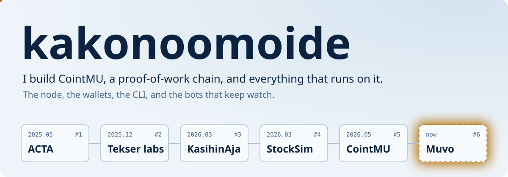
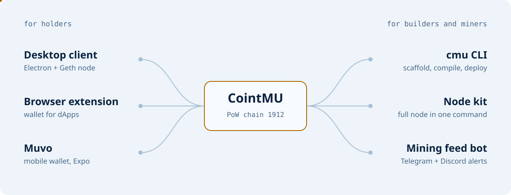

<picture>
  <source media="(prefers-color-scheme: dark)" srcset="assets/banner-dark.svg">
  
</picture>

*Kako no omoide* means "memories of the past". A blockchain is a ledger that never forgets, so the name fits what I build right now: a whole proof-of-work network, from the node that mines a block to the wallet in your pocket.

## Now building: CointMU

CointMU is an EVM chain (chain ID 1912) running on Geth. I work on every layer of it with the [Cointmu-ORG](https://github.com/Cointmu-ORG) team: what holders install, what builders deploy with, and what keeps the miners informed.

<picture>
  <source media="(prefers-color-scheme: dark)" srcset="assets/cointmu-dark.svg">
  
</picture>

| Repository | What it does | Built with |
|---|---|---|
| [CointMU-App](https://github.com/Cointmu-ORG/CointMU-App) | Desktop client: Geth PoW node, wallet, miner control, block explorer and node dashboard. Ships a companion browser extension wallet. | Electron, React, Vite, ethers |
| [CointMU-MobileApp](https://github.com/Cointmu-ORG/CointMU-MobileApp) | **Muvo**, a non-custodial mobile wallet for Android and iOS. | Expo, React Native, ethers v6 |
| [CointMU-CLI](https://github.com/Cointmu-ORG/CointMU-CLI) | `cmu`: scaffold projects, compile Solidity, run deploy scripts, manage wallets. | TypeScript, Solidity |
| [CointMU-Bot](https://github.com/Cointmu-ORG/CointMU-Bot) | Announces every new block and who mined it, and alerts when a node goes down. | Node.js, Telegram, Discord |
| [CointMU-Docs](https://github.com/Cointmu-ORG/CointMU-Docs) | Docs for the CLI, wallets, mining and contract deployment. | Markdown |
| Node kit | One command to stand up a full node and manage its identity. Private for now. | Shell, Geth |

## Earlier blocks

The chain in the banner, oldest first:

- **[ACTA](https://github.com/kakonoomoidee/Hackathon-JagoanTante)**: decentralized digital contracts anyone can create and sign. Hackathon build on the Internet Computer, in Motoko.
- **[Tekser labs](https://github.com/kakonoomoidee/linux-exam)**: Linux practicum and exam platforms for students. One isolated Docker container per student, graded in real time.
- **[KasihinAja](https://github.com/kakonoomoidee/KasihinAja)**: Web3 tipping for live streamers, with smart contracts, a MetaMask creator dashboard and OBS overlays.
- **[StockSim](https://github.com/kakonoomoidee/StockMarket)**: a stock market simulation with AI trading bots and a real-time order matching engine.

## Tools I reach for

  

Banner and map are hand-built SVGs; regenerate them with <code>python3 assets/src/build.py</code>.
